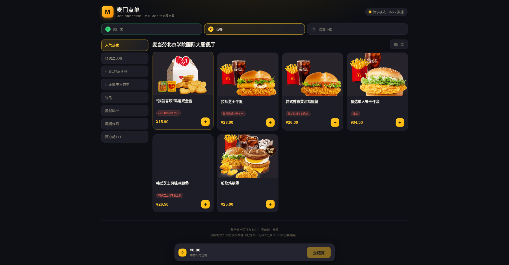
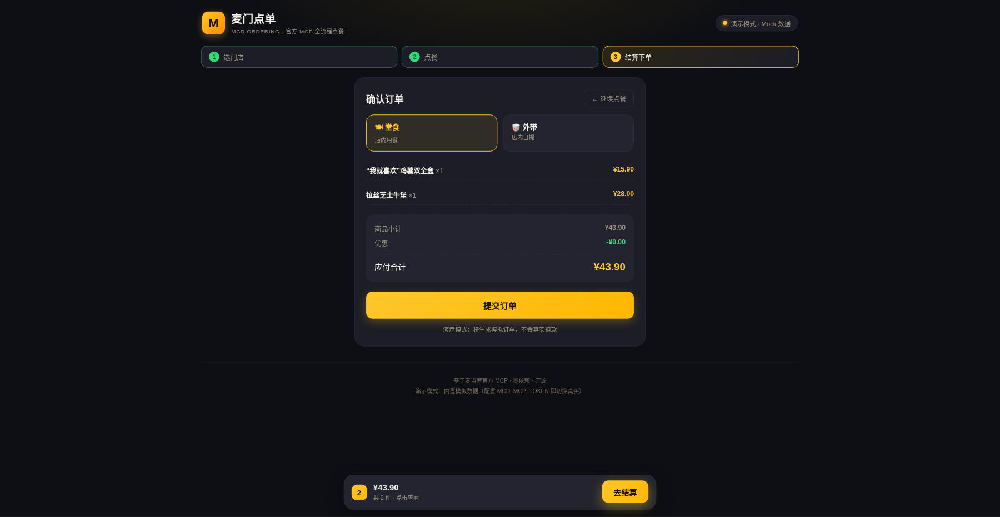
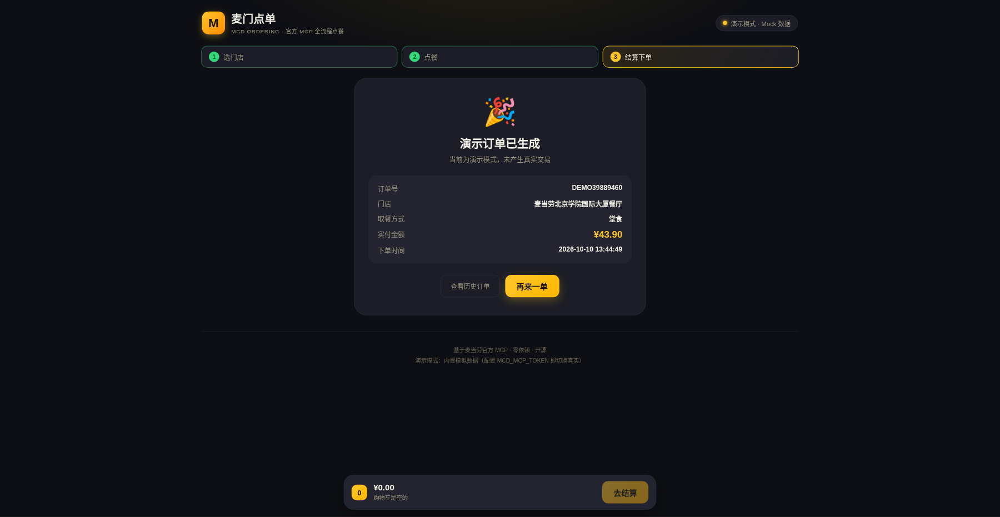

<div align="center">

# 麦门点单 · MCD Ordering

**麦当劳 MCP 全流程点餐体验：选店 → 菜单 → 选配 → 计价 → 一键下单**

基于麦当劳中国 MCP 真实点餐链路（门店/菜单/详情/计价/下单）的 Web 应用

   

</div>

---

## 🚀 在线体验

点开即玩，无需安装任何环境（演示模式内置模拟数据，体验完整点餐流程）：

<p align="center">
  <a href="https://mxuhajopfxuf.cloud.sealos.io">
    
  </a>
</p>

> 在线版为**演示模式**（Demo 单不真实扣款，放心体验全流程）。部署者配置 `MCD_MCP_TOKEN` 后自动切换**真实模式**直连麦当劳官方 MCP 下单。

---

## 界面截图

<p align="center">
  
</p>

<p align="center">
  
</p>

<p align="center">
  
</p>

*上：门店选择与菜单（分类 + 餐卡） · 中：结算（堂食/外带 + 明细 + 合计） · 下：演示下单成功结果页*

---

## 这是什么？

麦门点单是**首个把麦当劳 MCP「点餐下单链路」9 个工具完整串成闭环**的参赛应用：打开页面 → 选附近门店 → 浏览真实菜单 → 打开餐品看详情与选配 → 加购物车 → 官方接口实时计价 → 一键下单。

- **选店**：`query-nearby-stores` 获取附近/收藏门店，一键切换；
- **真菜单**：`query-meals` + `query-meal-detail` 拉取全部分类与餐品，名称/图片/价格/选配（rounds/choices）全部来自麦当劳官方；
- **智能计价**：`calculate-price` 官方实时计算，堂食/外带取餐方式可选；
- **一键下单**：`create-order` 官方下单（演示模式生成 DEMO 单不扣款；真实模式直连官方）；
- **历史订单**：`order-list` 查看真实历史订单；
- **双模式安全设计**：无 Token 自动演示（公开可玩），配 Token 自动真实（部署者专属）；
- **零依赖**：仅用 Node.js 内置能力，`node server.js` 直接运行。

一句话：**别人在 App 里翻半天，你在麦门点单三步点完。** 官方 35 个 MCP 工具中，「点餐下单链路」是尚未被参赛者展示过完整闭环的最大蓝海。

## 功能特性

| 功能 | 说明 |
|---|---|
| 附近门店 | 真实门店列表（名称/地址/距离/预约支持），一键切换 |
| 全量菜单 | 15 分类 100+ 餐品，分类侧栏 + 餐卡网格（真实图片/价格/标签） |
| 餐品详情弹层 | 选配（必选/多选、差价）、数量步进、实时计价 |
| 购物车 | 加购/改量/删除/清点，底部常驻购物车栏 |
| 官方计价 | `calculate-price` 实时返回商品小计/优惠/应付合计 |
| 取餐方式 | 堂食 / 外带店内自提 二选一 |
| 一键下单 | 演示模式生成 DEMO 单（不真实扣款）；真实模式直连官方 `create-order` |
| 历史订单 | `order-list` 真实历史订单抽屉（单号/门店/明细/金额/时间） |
| 双模式徽标 | 页面明确标识「演示模式 · Mock 数据 / 真实模式 · 官方 MCP」 |
| 响应式 | 桌面多栏 / 移动端单列自适应，零外部依赖 |

## 快速开始

### 环境要求

- Node.js **18 或更高版本**（内置 `fetch`，零第三方依赖，无需 `npm install`）

### 1. 克隆并启动（演示模式）

```bash
git clone https://github.com/odin1024/mcd-ordering.git
cd mcd-ordering
node server.js
```

打开浏览器访问 `http://localhost:3002`，从选门店开始完整体验点餐全流程（此时使用内置模拟数据，界面显示"演示模式"徽标）。

### 2. 接入真实麦当劳 MCP（真实下单模式）

从 [麦当劳 MCP 官方平台](https://open.mcd.cn/mcp) 登录并激活申请 MCP Token（此 Token 代表您的麦当劳会员身份，请严格保管）。

```bash
export MCD_MCP_TOKEN=你的Token
node server.js
```

服务启动日志会显示真实模式，界面徽标变为「真实模式 · 官方 MCP」，门店/菜单/计价/下单全部来自麦当劳官方实时接口。

> 安全提醒：请通过环境变量传入 Token，**切勿**把 Token 写入代码、配置示例或提交到仓库。

## 使用示例

启动后打开页面：

```text
┌─────────────────────────────────────────────────┐
│  🍟 麦门点单                          [演示模式] │
│  ①选门店 → ②点餐 → ③结算下单                    │
│  ┌─ 选择门店（真实数据 · 到店自取）────────────┐ │
│  │ 麦当劳北京学院国际大厦餐厅   📍知春路1号    │ │
│  │ 麦当劳北京路松街餐厅       📍路松街地铁站A口│ │
│  │ 麦当劳北京中关村大街餐厅   📍中关村大街19号 │ │
│  └───────────────────────────────────────────┘ │
│  ── 人气热卖 ──                                  │
│  "我就喜欢"鸡薯双全盒    ¥15.90   [＋]          │
│  拉丝芝士牛堡            ¥28.00   [＋]          │
│  ── 结算 ──                                      │
│  🍽堂食 / 🥡外带  商品小计 ¥43.90              │
│  优惠 -¥0.00  应付合计 ¥43.90   [提交订单]      │
│  🎉 演示订单已生成  DEMO37419149（不真实扣款）   │
└─────────────────────────────────────────────────┘
```

## 真实使用麦当劳 MCP

| MCP 工具 | 用途 | 在本项目中的作用 |
|---|---|---|
| `query-nearby-stores` | 查询附近/收藏门店 | 门店列表（含地址/距离/预约支持） |
| `query-meals` | 查询门店菜单分类 | 菜单分类侧栏 + 餐品 code/tags |
| `query-meal-detail` | 查询餐品详情 | 名称/图片/价格/选配（rounds/choices） |
| `calculate-price` | 实时计价 | 商品小计/优惠/应付合计 + 取餐方式 |
| `create-order` | 创建订单 | 演示模式生成 DEMO 单 / 真实模式官方下单 |
| `order-list` | 历史订单 | 历史订单抽屉 |

完整的接入地址、协议、调用流程与安全边界见 [MCP_INTEGRATION.md](./MCP_INTEGRATION.md)。

## 目标用户

- 麦当劳高频顾客：想快速知道附近门店今天有什么、点什么、花多少钱；
- 点餐纠结症患者：真实菜单 + 真实价格 + 选配，下单前心里有数；
- 对"AI 应用真实调用品牌 MCP 全流程写操作"感兴趣的开发者；
- 想体验"不用装 App 也能点麦当劳"极简场景的好奇用户。

## 测试

```bash
node --test test/*.test.js
```

覆盖：官方混合文本响应解析（说明文字+内嵌 JSON+尾部规则）、门店/菜单/详情/计价/演示下单/历史订单、双模式判定。当前 **9/9 全部通过**。

## 项目结构

```text
.
├── CONTEST_DECLARATION.md   # 官方参赛声明（内容不可修改）
├── MCP_INTEGRATION.md       # 麦当劳 MCP 集成说明
├── mcp-config.example.json  # 脱敏 MCP 配置示例（仅环境变量占位符）
├── docs/                    # README 配图（线上运行截图）
├── examples/
│   └── mock-data.json       # 无 Token 演示用模拟数据（严格贴近官方格式）
├── public/                  # 前端点餐 UI（零外部依赖）
├── src/
│   ├── mcp-client.js        # 零依赖 MCP Streamable HTTP 客户端（增强响应解包）
│   └── ordering-engine.js   # 点餐引擎：门店/菜单/详情/计价/下单状态机
├── test/                    # 自动化测试（node --test）
└── server.js                # HTTP 服务入口（7 个 API + 双模式判定）
```

## 安全边界

- 不在仓库、配置示例、命令脚本中保存任何真实 Token、手机号、地址等个人信息；
- 未配置 Token 时自动进入演示模式，演示单不真实扣款，不会发起任何外网请求；
- 本项目真实模式仅调用麦当劳 MCP 的**点餐下单链路**能力，下单前必须经过官方 `calculate-price` 计价确认；
- 餐品、价格、供应状态以麦当劳官方渠道的实时结果为准。

## 📮 反馈与联系

用起来有想法、遇到问题，或想要更多麦门玩法？欢迎扫码关注公众号 **知白守黑** 私信我，每条反馈都会认真看 👇

<p align="center">
  
</p>

## License

[MIT](./LICENSE)

---

本项目是 **麦当劳程序员创意开发大赛** 参赛作品，由参赛者独立开发，**非麦当劳官方产品**。
